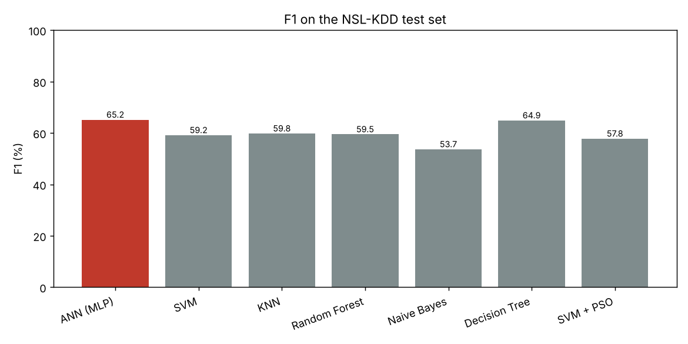

# Cyber Threat Detection Based on Artificial Neural Networks Using Event Profiles

This was my B.Tech final year project, based on the IEEE Access paper with the same title.

Security logs are huge, and rule-based systems miss a lot. The idea of the paper is to turn each network record into an **event profile** (a short text of `feature=value` tokens), convert those profiles into vectors with **TF-IDF**, and train an **artificial neural network** to tell normal traffic from different kinds of attacks. I compare the neural network with classic machine learning models trained on exactly the same vectors.

## How it works

1. Load the NSL-KDD training and test files
2. Group the 39 attack names into 4 attack categories: DoS, Probe, R2L, U2R (plus normal)
3. Build an event profile for every record, e.g. `protocol_type=tcp service=http flag=SF src_bytes=215 ...`
4. TF-IDF on the event profiles (fitted on the training data only)
5. Train the neural network (multi-layer perceptron, 256 and 128 neurons) and SVM, KNN, Random Forest, Naive Bayes and Decision Tree
6. Extension: binary Particle Swarm Optimization (PSO) selects a smaller set of features, then an SVM is trained on them
7. Score every model on the **test file**, which no model sees during training

The test file also contains attack types that never appear in the training file (for example `apache2`, `mscan`, `httptunnel`), so this is a realistic test.

## Results (NSL-KDD test set, 9,999 records)

| Model         | Accuracy | Precision | Recall |    F1 |
|:--------------|---------:|----------:|-------:|------:|
| ANN (MLP)     |    91.37 |     89.05 |  60.85 | 65.17 |
| SVM           |    91.38 |     75.61 |  57.35 | 59.16 |
| KNN           |    90.32 |     75.29 |  56.98 | 59.81 |
| Random Forest |    90.46 |     95.36 |  56.75 | 59.49 |
| Naive Bayes   |    88.55 |     54.90 |  53.13 | 53.68 |
| Decision Tree |    91.20 |     88.01 |  61.38 | 64.90 |
| SVM + PSO     |    90.71 |     73.80 |  56.33 | 57.81 |

Precision, recall and F1 are macro averages over the 5 classes, so every class counts equally.



**What the numbers say**

- Accuracy is around 90% for every model, because most records are normal or DoS, which are easy. Macro F1 shows the real difference.
- The neural network has the best macro F1 (65.2%), with the decision tree close behind.
- All models struggle with **R2L and U2R attacks**. The training file has only 81 R2L and 4 U2R examples, so the models rarely learn them. In the confusion matrix (`results/ann_confusion_matrix.csv`), most R2L attacks are predicted as normal.
- PSO kept about half of the features (1,548 of 3,223) with almost the same accuracy, but it did not improve the results here.

## How to run

```bash
pip install -r requirements.txt
python cyber_threat_detection.py            # full run, about 6 minutes (PSO is the slow part)
python cyber_threat_detection.py --no-pso   # without PSO, under a minute
```

On Windows you can also double-click `run.bat`. Results and graphs are saved in the `results` folder.

## Data

- `kdd_train.csv`, `kdd_test.csv`: 10,000-record samples of the NSL-KDD train and test sets. These are used for all results above.
- `*-WorkingHours*.csv`: 10,000-row samples from the CIC-IDS2017 daily files. They contain almost only normal traffic (fewer than 10 attack rows in total), so they are **not used**. To use CIC-IDS2017 properly, download the full dataset from the Canadian Institute for Cybersecurity.

## What I would improve next

- Balance the rare classes (class weights or oversampling) so R2L and U2R are detected better
- Train on the full NSL-KDD and CIC-IDS2017 datasets
- Try a sequence model on time-ordered events
